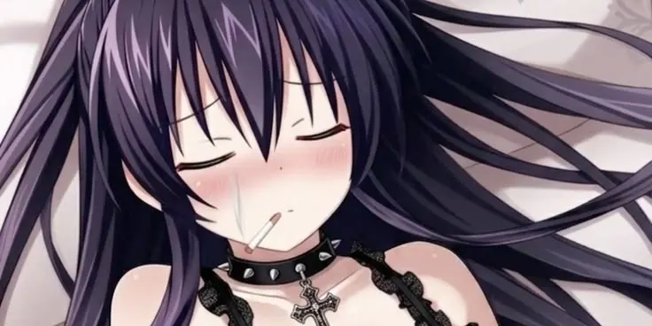
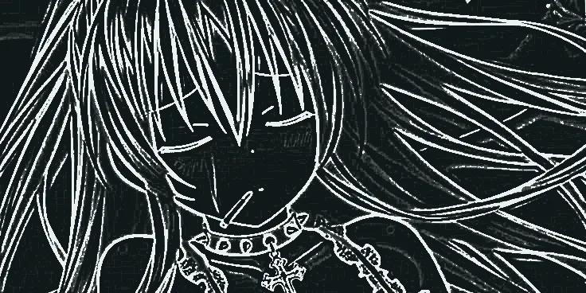
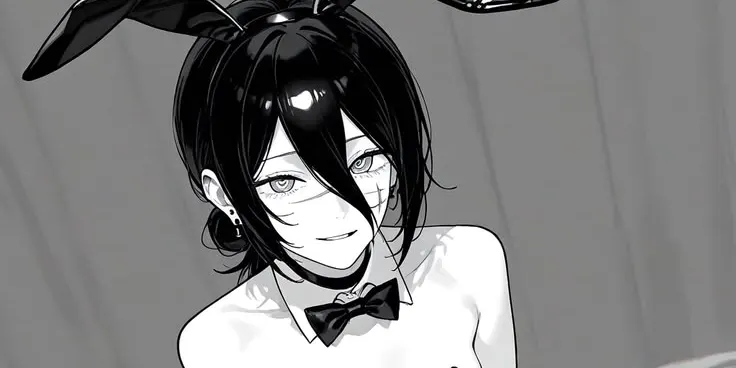
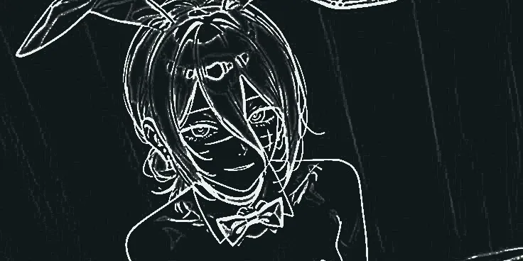
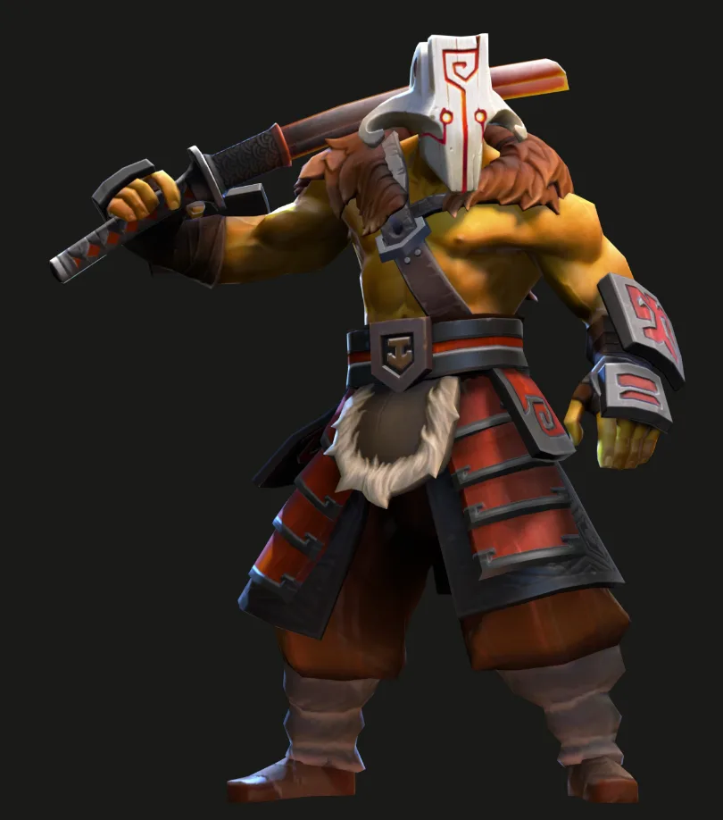
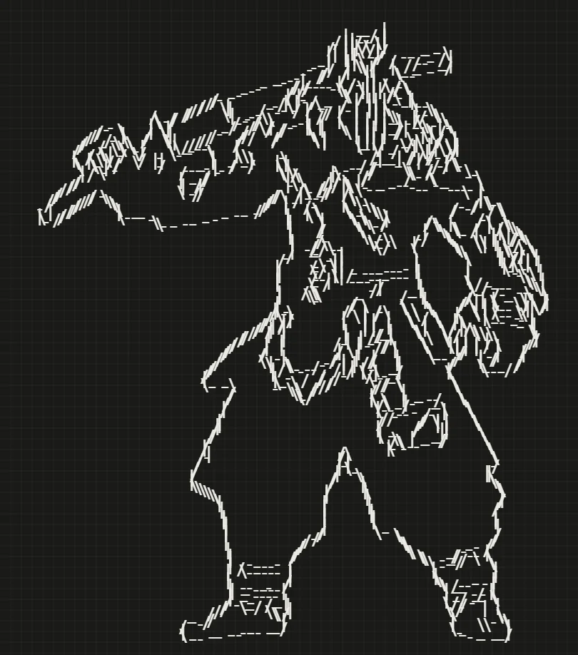
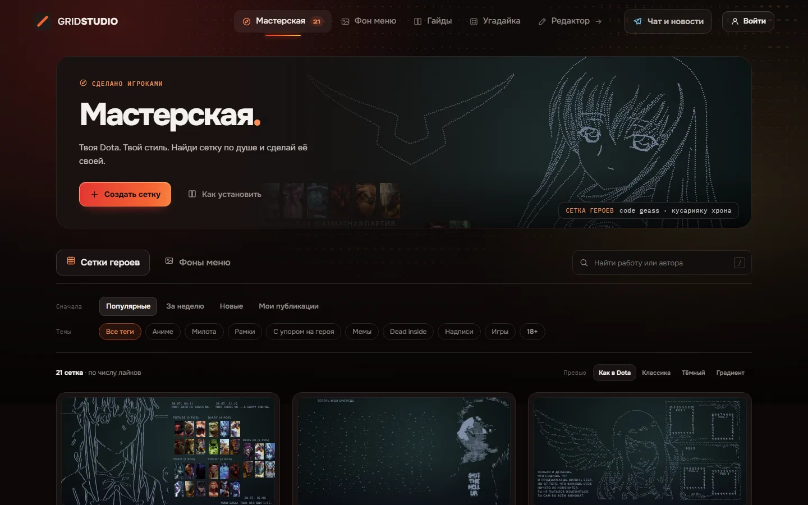

<p align="center">
  
</p>

<h1 align="center">Dota 2 Grid Studio</h1>

<p align="center">
  <b>Сетка героев — твой холст.</b><br>
  Рисуй, превращай картинки в арт и забирай готовый файл для Dota 2.<br>
  <sub>Бесплатно · прямо в браузере · без установки</sub>
</p>

<p align="center">
  <a href="https://shttps.github.io/GridPainter/"></a>
  <a href="https://shttps.github.io/GridPainter/editor.html"></a>
  <a href="https://shttps.github.io/GridPainter/workshop.html"></a>
</p>

<p align="center">
  
  
  
  <a href="LICENSE"></a>
</p>

<p align="center">
  
</p>

---

## ✨ Что умеет

| | |
|---|---|
| ✏️ **Редактор** | ASCII, текст и портреты героев, карандаш, фигуры, группы |
| 🖼 **Арт из картинки** | Line-art, ASCII или мозаика из героев — вставь картинку и получи готовую сетку |
| 🎮 **«Как в игре»** | Превью в стилях Доты: видишь результат без запуска игры |
| 🌐 **Мастерская** | Сетки и фоны главного меню от игроков: лайки, скачивания, профили авторов |
| 🎬 **Фон меню** | Свой фон (в том числе видео) на главный экран Доты, под сеткой героев |
| 🧩 **Профиль Steam** | Брайль-арт для «Своего информационного поля» в один клик |
| 🎯 **Мини-игры** | «Взлом замка» и «Сапёр Сплин» с рекордами, «Угадайка» героя дня |

## 🎨 Примеры

Картинка → арт из символов героев за пару кликов:

<table>
  <tr>
    <td align="center"><br><sub>исходник</sub></td>
    <td align="center"><br><sub>line-art</sub></td>
  </tr>
  <tr>
    <td align="center"><br><sub>исходник</sub></td>
    <td align="center"><br><sub>line-art</sub></td>
  </tr>
  <tr>
    <td align="center"><br><sub>герой Доты</sub></td>
    <td align="center"><br><sub>контур из символов</sub></td>
  </tr>
</table>

**Готовые сетки из Мастерской** — открой, посмотри в стиле «Как в Dota» и скачай:

- 🖤 [**hate**](https://shttps.github.io/GridPainter/grid.html?id=ec784e9d-53b8-45ba-9145-9200d89773bf) — смешанная сетка, 4 120 категорий
- 🎴 [**Вторая сетка**](https://shttps.github.io/GridPainter/grid.html?id=152334d1-a0f2-45ea-b927-3027998ac2b9) — живое превью и скачивание

<table>
  <tr>
    <td align="center"><br><sub>в редакторе</sub></td>
    <td align="center"><br><sub>та же сетка в Dota 2</sub></td>
  </tr>
  <tr>
    <td align="center"><br><sub>Мастерская</sub></td>
    <td align="center"><br><sub>в игре</sub></td>
  </tr>
</table>

## 🚀 Как поставить сетку за 4 шага

1. Открой [редактор](https://shttps.github.io/GridPainter/editor.html) (лучше Chrome или Edge) или выбери сетку в [Мастерской](https://shttps.github.io/GridPainter/workshop.html).
2. Брось картинку на холст или нарисуй сам.
3. **Экспорт → Записать в файл** — в папку Steam, предварительно закрыв Доту:
   `...\Steam\userdata\<ID>\570\remote\cfg\hero_grid_config.json`
4. В игре: **Герои → Сортировка → твоя сетка**.

> ⚠️ Файл заменяет все твои сетки. Чтобы добавить новую к своим — открой её в редакторе, загрузи свой JSON и сделай экспорт.

## 🛠 Для разработчиков

Чистые HTML/CSS/JS, сборки нет — открой `index.html` или подними любой статический сервер:

```bash
python -m http.server 8000
```

- **Мастерская, вход и профили** работают на [Supabase](https://supabase.com): схема — [`supabase/schema.sql`](supabase/schema.sql), ключи — [`config.js`](config.js). Без базы сайт работает в демо-режиме.
- **Новый герой в Доте:** `pip install pillow`, затем `python update_heroes.py` и `python update_game.py`.

## 💬 Связь и лицензия

Discord: **@ahttps** — вопросы, заказы сеток, предложения.

© 2026 shttps. Все права защищены; своими рисунками можно пользоваться свободно — подробности в [LICENSE](LICENSE). Dota 2 — товарный знак Valve Corporation, проект с Valve не связан.

Спасибо: [d2grid](https://github.com/mkk5/d2grid) · [dota_vpk_updates](https://github.com/spirit-bear-productions/dota_vpk_updates) · [DotaHeroGridStudio](https://github.com/T1me1k/DotaHeroGridStudio) · [OpenDota](https://www.opendota.com/)
