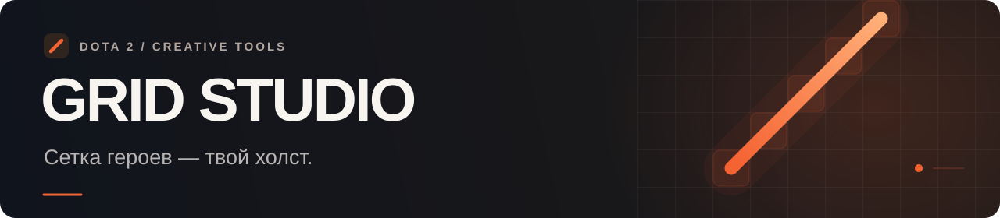
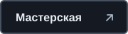
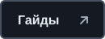
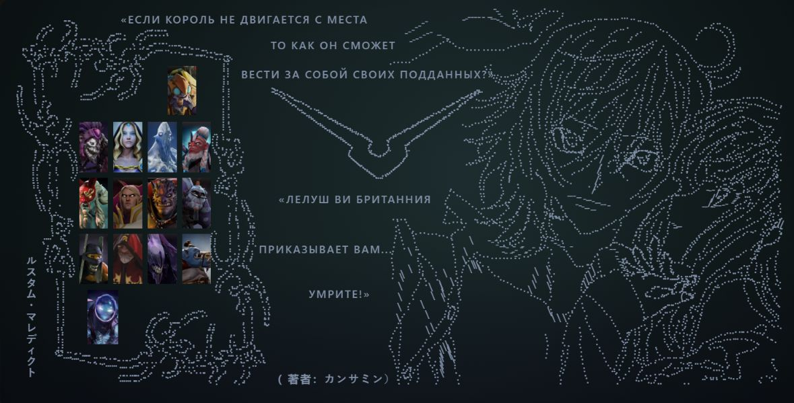
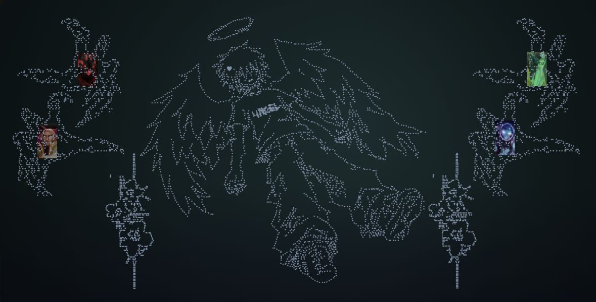

<p align="center">
  <a href="https://shttps.github.io/GridPainter/">
    
  </a>
</p>

<p align="center">
  Рисуй сетки для Dota 2, превращай картинки в ASCII и собирай мозаику из героев.<br>
  <sub>Бесплатно · в браузере · с превью «Как в игре»</sub>
</p>

<p align="center">
  <a href="https://shttps.github.io/GridPainter/editor.html"></a>
  <a href="https://shttps.github.io/GridPainter/workshop.html"></a>
  <a href="https://shttps.github.io/GridPainter/guides.html"></a>
</p>

<p align="center">
  <a href="https://shttps.github.io/GridPainter/"></a>
</p>

### Сделано в Grid Studio

<table>
  <tr>
    <td width="50%">
      <a href="https://shttps.github.io/GridPainter/grid.html?id=1f804b4b-e09e-4893-8f2d-7f60d155e220"></a>
    </td>
    <td width="50%">
      <a href="https://shttps.github.io/GridPainter/grid.html?id=ec784e9d-53b8-45ba-9145-9200d89773bf"></a>
    </td>
  </tr>
  <tr>
    <td><a href="https://shttps.github.io/GridPainter/grid.html?id=1f804b4b-e09e-4893-8f2d-7f60d155e220"><b>Код Гиас ↗</b></a><br><sub>ASCII · рамки · герои</sub></td>
    <td><a href="https://shttps.github.io/GridPainter/grid.html?id=ec784e9d-53b8-45ba-9145-9200d89773bf"><b>hate ↗</b></a><br><sub>Символы · портреты · свой стиль</sub></td>
  </tr>
</table>

Открой любую сетку, чтобы посмотреть превью, скачать или переделать под себя.

### Из браузера — в Dota 2

1. Создай сетку в редакторе или выбери готовую в Мастерской. Скачай `hero_grid_config.json`.
2. Закрой Dota 2 и положи файл в `Steam\userdata\<ID>\570\remote\cfg\`.
3. В игре открой **Герои → Сортировка** и выбери свою сетку.

> Замена файла перезапишет старые сетки. Чтобы сохранить их, сначала открой текущий JSON в редакторе и экспортируй новую сетку под новым названием.

<details>
<summary>Локальный запуск</summary>

HTML, CSS и JavaScript, без сборки. Из папки проекта:

```bash
python -m http.server 8000
```

Открой [localhost:8000](http://localhost:8000). Мастерская и аккаунты используют Supabase: [настройки](config.js) · [схема базы](supabase/schema.sql).

</details>

---

<sub>Discord: <b>@ahttps</b> · © 2026 shttps · <a href="LICENSE">Все права защищены</a><br>
Dota 2 принадлежит Valve. Проект не связан с Valve.</sub>
