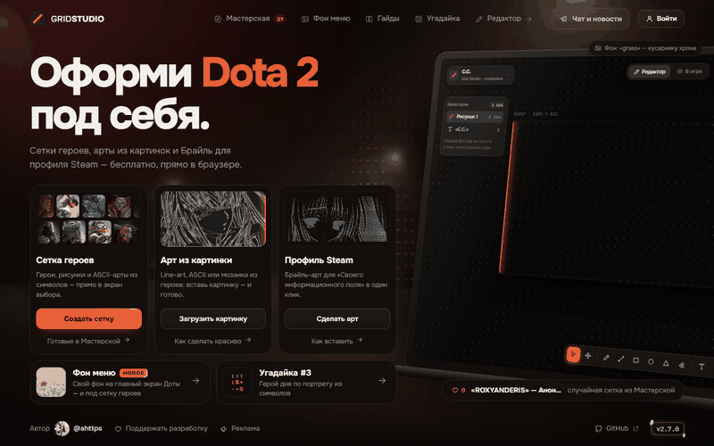
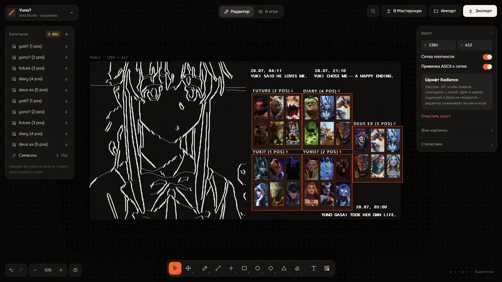

<p align="center">
  
</p>

<h1 align="center">Dota 2 Grid Studio</h1>

<p align="center">
  <b>Сетка героев — твой холст.</b><br>
  Рисуй, превращай картинки в арт и забирай готовый файл для Dota 2.
</p>

<p align="center">
  <a href="https://shttps.github.io/GridPainter/"><b>▶ Открыть сайт</b></a> ·
  <a href="https://shttps.github.io/GridPainter/editor.html">Редактор</a> ·
  <a href="https://shttps.github.io/GridPainter/workshop.html">Мастерская</a> ·
  <a href="https://shttps.github.io/GridPainter/guides.html">Гайды</a> ·
  <a href="https://shttps.github.io/GridPainter/arcade.html">Мини-игры</a>
</p>

<p align="center">
  
</p>

## Что внутри

- ✏️ **Редактор** — ASCII, текст и портреты героев, карандаш, фигуры, группы.
- 🖼 **Арт из картинки** — line-art, ASCII или мозаика из героев.
- 🎮 **«Как в игре»** — превью по стилям Доты, без запуска игры.
- 🌐 **Мастерская** — сетки и фоны главного меню от игроков.
- 🧩 **Профиль Steam** — брайль-арт для «Своего информационного поля».
- 🎯 **Мини-игры** — «Взлом замка» и «Сапёр Сплин» из Доты с рекордами и «Угадайка» героя дня.

| Редактор | В игре |
|:---:|:---:|
|  |  |

## Как пользоваться

1. Открой [редактор](https://shttps.github.io/GridPainter/editor.html) — ставить ничего не нужно (лучше Chrome или Edge).
2. Брось картинку на холст или нарисуй сам.
3. **Экспорт → Записать в файл** в папку Steam, предварительно закрыв Доту:
   `...\Steam\userdata\<ID>\570\remote\cfg\hero_grid_config.json`
4. В игре: «Герои» → «Сортировка» → твоя сетка.

## Запуск и устройство

Чистые HTML/CSS/JS, сборки нет — достаточно открыть `index.html` или поднять любой статический сервер:

```bash
python -m http.server 8000
```

- Мастерская, вход и профили работают на [Supabase](https://supabase.com): схема — [`supabase/schema.sql`](supabase/schema.sql), ключи — [`config.js`](config.js). Без базы сайт работает в демо-режиме.
- Новый герой в Доте: `pip install pillow`, затем `python update_heroes.py` и `python update_game.py`.

## Связь и лицензия

Discord: **@ahttps** — вопросы, заказы сеток, предложения.

© 2026 shttps. Все права защищены; своими рисунками можно пользоваться свободно. Подробности — в [LICENSE](LICENSE). Dota 2 — товарный знак Valve Corporation, проект с Valve не связан.

Спасибо: [d2grid](https://github.com/mkk5/d2grid), [dota_vpk_updates](https://github.com/spirit-bear-productions/dota_vpk_updates), [DotaHeroGridStudio](https://github.com/T1me1k/DotaHeroGridStudio), [OpenDota](https://www.opendota.com/).
