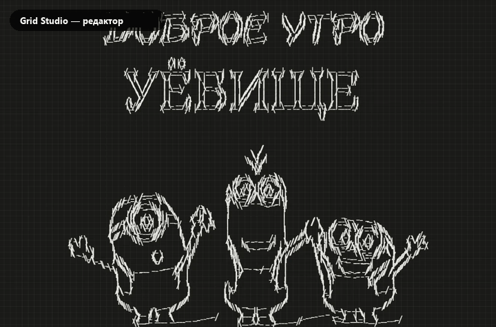
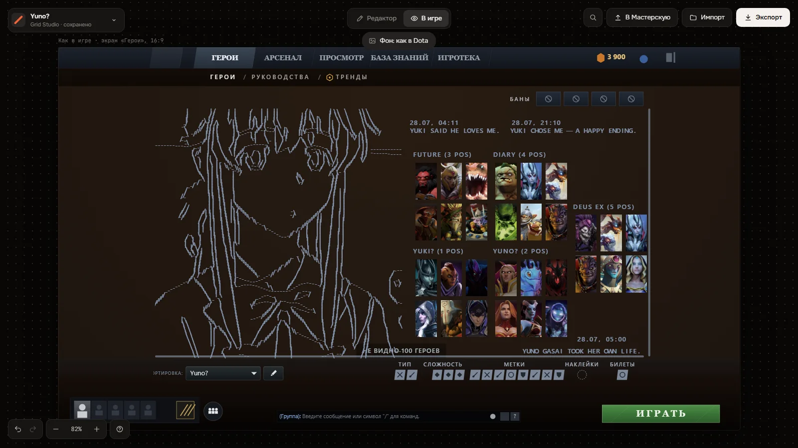

<p align="center">
  
</p>

<h1 align="center">Dota 2 Grid Studio</h1>

<p align="center">
  Редактор кастомных сеток героев Dota 2: рисуй ASCII-арт, превращай картинки в line-art<br>
  или мозаику из героев — и получай готовый <code>hero_grid_config.json</code>.
</p>

<p align="center">
  <a href="https://shttps.github.io/GridPainter/"><b>▶ Открыть сайт</b></a>
  &nbsp;·&nbsp;
  <a href="https://shttps.github.io/GridPainter/editor.html">Редактор</a>
  &nbsp;·&nbsp;
  <a href="https://shttps.github.io/GridPainter/workshop.html">Мастерская</a>
  &nbsp;·&nbsp;
  <a href="https://shttps.github.io/GridPainter/guides.html">Гайды</a>
  &nbsp;·&nbsp;
  <a href="https://shttps.github.io/GridPainter/game.html">Угадайка</a>
  &nbsp;·&nbsp;
  Discord: <b>@ahttps</b>
</p>

<p align="center">
  
</p>

## Что это

В Dota 2 в экране выбора героя есть «Сетка героев»: её можно настроить под себя, раскидав героев по категориям. Dota 2 Grid Studio использует это как холст. Каждая категория сетки становится «пикселем» рисунка:

- **символом** — пустая категория с названием `.`, `/`, `|` и т. д.;
- **строкой текста**;
- **героем** — портрет подбирается по цвету.

Всё рисуется в браузере, результат экспортируется в файл, который Дота читает как обычную сетку.

| Редактор | В игре |
|:---:|:---:|
|  |  |

## Возможности

**Импорт картинок — три режима, с превью «сравнение / результат / кадр»**
- **Детализация 2k / 5k / 8k / 12k.** Выбираешь, сколько категорий не жалко, — плотность подбирается сама: максимум деталей в этом бюджете. Режим «Вручную» оставляет плотность и лимит за тобой.
- **Кадр.** «Вписать» или «Заполнить холст», масштаб до 400 % и сдвиг мышью — картинка занимает весь экран героев, а не полоску посередине.
- **Line-art.** Контуры через Canny edge detection (как в Photoshop) с учётом цветовых границ. Контуры сшиваются в линии, символы `- \ | /` ставятся вдоль них и поворачиваются по касательной; короткий шум и двойные контуры тонких линий отбрасываются. **Тени точками** дорисовывают тон между контурами (символ `·`, `.`, `•` или `:`). Есть режим «только точки».
- **ASCII по яркости.** Наборы символов `.:-=+*#%@`, `░▒▓█`, точки или свой. Есть режим «Брайль строками», очень экономный по количеству категорий.
- **Мозаика из героев.** Каждая клетка — портрет героя, подобранный по среднему цвету. Есть дизеринг, удаление фона и исключение героев из палитры.
- **Картинка:** авто-уровни, резкость, яркость, контраст; удаление фона по цвету края. В превью колесо — зум, чтобы рассмотреть детали. Результат можно добавить на холст или заменить им холст.

**Арт для профиля Steam**
- **+ у панели «Категории» → Арт для профиля Steam…** превращает картинку в Брайль-арт для витрины «Своё информационное поле» (Custom Info Box).
- Ширина по умолчанию — 60 символов, есть счётчик «N / 8000» и кнопка «Влезть в 8000», которая сама подбирает ширину под лимит Steam.
- Пробелы заменяются на пустой символ Брайля, чтобы Steam не съедал отступы. Готовый текст копируется одной кнопкой.

**Pixel ASCII Editor**
- Карандаш, линия, горизонталь/вертикаль, прямоугольник, эллипс, ромб, треугольник (контуром или с заливкой), ластик по области.
- 14 перьев-пресетов и свой символ, настраиваемая плотность сетки.
- Выделение, перетаскивание, группы.
- Действия с группами: масштаб, «Заполнить холст», поворот на 90°, отражения. Символы при повороте тоже меняются: `|` ↔ `-`, `/` ↔ `\`.
- Фон-картинка с приглушением, чтобы обводить.
- Генератор линий, вставка ASCII из буфера и копирование выделения обратно в ASCII.
- Категории героев с выбором героев, текстовые категории.

**Режим «В игре»**
- Переключатель **Редактор / В игре** сверху (или `Tab`) показывает экран «Герои» Доты целиком: меню, баны, «Не видно N героев», сортировку с названием твоей сетки, фильтры и кнопку «Играть».
- Сетка рисуется по настоящим стилям Доты (`hero_grid_new.css`): подписи ЗАГЛАВНЫМИ, 16px, разрядка 2px, цвет `#808fa6`, отступ 4px. Название категории героев стоит в строке 20px над портретами. Портреты вертикальные, приглушённые (saturation 0.7), с отступом 4px.
- Всё, что выходит за область 1204 × 612, в игре уходит под прокрутку — превью показывает это так же.
- Редактор рисует текст той же геометрией, поэтому ширина надписей и расстояния совпадают с игрой.

**Первое знакомство**
- При первом входе в редактор — окно «С чего начнём?»: картинка, рисование, свой JSON или готовая сетка.
- Тур по интерфейсу из 7 шагов (меню у названия → «Подсказки» или `Ctrl+K` → «Подсказки»), подсказки к месту: после первого арта — «посмотри в игре», после превью — «куда класть файл», при большом числе категорий — как сэкономить.

**Профиль и «Мои работы»** (включается после настройки, см. «Аккаунты»)
- Вход по ссылке на почту, по желанию — через Discord или GitHub. Пароль не нужен.
- «Мои работы» — приватные: видит только владелец. В редакторе: меню у названия → «Сохранить в мои работы» (`Ctrl+Shift+S`), дальше работа сохраняется сама через пару секунд после правки. Открыть — со страницы профиля, с любого устройства.
- Публикация в Мастерскую от своего имени; свою сетку можно удалить с любого устройства. У каждого автора — публичная страница со всеми его сетками.
- Аватар: своя картинка, портрет любого героя или картинка из Discord/GitHub. «О себе», ссылка на Steam, цифры (работы, сетки, лайки, скачивания), ссылка на профиль.
- Работы можно переименовать и скачать готовым `hero_grid_config.json` прямо из профиля; вкладка «Понравившиеся» собирает сетки, которым ты ставил лайк.

**Главная**
- Фон — поле ASCII-символов, которое переливается волнами и светится у курсора. Символы рисуются из готового атласа и одной заливкой градиента, а панели над фоном без «стекла» (`backdrop-filter`), поэтому главная не тормозит.
- Панели разделов с подсветкой за курсором: сетка героев, арт из картинки, Брайль для Steam, фоны меню и «Угадайка» дня.
- На экране ноутбука открыта случайная сетка из Мастерской — живым холстом, со своим названием и числом категорий; в панели «Фоны меню» — постер одного из популярных фонов.
- Примеры артов: аниме-контуры, контуры с тенями точками и рендер героя — переключаются в блоке «Картинка → line-art».

**Гайды и «Угадайка»**
- [Гайды](https://shttps.github.io/GridPainter/guides.html): как поставить сетку в Доту, line-art, который читается в игре, сколько категорий можно, мозаика, Брайль для Steam, текст, профиль и Мастерская.
- [Угадайка](https://shttps.github.io/GridPainter/game.html): угадай героя по цветному портрету из символов. Герой дня (один на всех, номер дня, серия и статистика, «Поделиться») и бесконечный режим. С каждой ошибкой арт чётче и открывается подсказка (атрибут, тип атаки, роли, первая буква), а у каждой попытки видно, что совпало с загаданным. Чёрно-белый режим — для хардкора.

**Мастерская** (`workshop.html`, бывший каталог — старые ссылки `catalog.html` переадресуются)
- Две вкладки: **Сетки** и **Фоны** главного меню (`workshop.html?backgrounds`).
- Сортировка: популярные, лучшие за неделю, новые, мои публикации. Поиск по названию и автору, теги (аниме, милота, рамки, мемы, Dead inside…) и пометка **18+**: такие работы размыты, пока не нажмёшь, можно один раз ответить «мне есть 18».
- Превью сеток живые: сетка рисуется на холсте прямо в карточке, с настоящими портретами героев, когда карточка доезжает до экрана. Подложка на выбор — «как в Dota» (тёмная бирюза нынешнего экрана «Герои»), «классика» (коричневый старый клиент), тёмная или градиент. Лайк ставится прямо с карточки.
- Страница сетки: превью «как в игре», «Открыть в редакторе», «Скачать», «Копировать JSON», лайк, ссылка, жалоба.
- **В Мастерскую** в редакторе выкладывает текущий холст: название, ник, описание, до 5 тегов и пометка 18+.
- Фоны: картинки, GIF и видео (MP4/WebM) с тегами и пропорциями экрана (16:9, 16:10, 21:9, 4:3). Видео в карточке играет при наведении; скачать можно в исходном качестве. Выкладывать фоны можно, войдя в профиль (картинки до 5 МБ, видео до 15 МБ).

**Файлы**
- Импорт одного или нескольких `hero_grid_config.json` с выбором сеток. Каждая категория после импорта двигается отдельно.
- Экспорт: арт дописывается к твоим сеткам, остальные не трогаются. В Chrome и Edge файл можно записать прямо на место.
- Загрузка шрифта Radiance (`.ttf`), чтобы превью совпадало с игрой.
- Панель «Категории» слева: каждый рисунок, мозаика, текст и категория героев — отдельная строка, клик выделяет объект на холсте.
- Палитра команд `Ctrl+K`: все действия и инструменты с поиском.
- Тёмная и светлая тема, отмена/повтор, автосохранение.

## Как пользоваться

1. Открой [редактор онлайн](https://shttps.github.io/GridPainter/editor.html) или скачай репозиторий и открой `index.html`. Ничего устанавливать не нужно. Chrome или Edge лучше всего: они умеют записывать файл на место.
2. Брось картинку на холст, нажми **+** у панели «Категории» → **Картинку** (или просто **Ctrl+V**), выбери режим и подкрути ползунки.
3. Открой меню у названия сетки (стрелка слева сверху) → **Открыть JSON** и выбери свой файл сетки, чтобы не потерять старые сетки. Он лежит тут:
   ```
   C:\Program Files (x86)\Steam\userdata\<твой ID>\570\remote\cfg\hero_grid_config.json
   ```
4. **Экспорт → Записать в файл** (или «Скачать» и положить файл в эту папку вручную). Перед этим закрой Доту.
5. В игре: вкладка «Герои» → «Сортировка» → выбери свою сетку.

## Горячие клавиши

| Действие | Клавиши |
|---|---|
| Все команды | `Ctrl+K` |
| Выделение / рука | `V` / `H`, пробел |
| Карандаш, линия, гор./верт. | `B`, `L`, `X` (старые `P`, `I` тоже работают) |
| Прямоугольник, эллипс, ромб, треугольник | `R`, `O`, `D`, `Y` |
| Ластик, текст, категория героев | `E`, `T`, `G` |
| Ровные линии / квадрат | `Shift` при рисовании |
| Группировать / разгруппировать | `Ctrl+G` / `Ctrl+Shift+G` |
| Дублировать, копировать, вставить | `Ctrl+D`, `Ctrl+C`, `Ctrl+V` |
| Отменить / повторить | `Ctrl+Z` / `Ctrl+Shift+Z` |
| Режим «В игре» / назад | `Tab`, `Esc` |
| Тема | `Shift+T` |
| Вписать холст | `Shift+1` |

## Как это устроено

- **Текст и символы.** Пишутся как категории с `width: 0`, `height: 0` и пустым `hero_ids`: Дота показывает только их название — заглавными буквами, с разрядкой 2px и отступом 4px от `x_position`.
- **Мозаика.** Использует то, как Дота раскладывает героев. Карточка героя имеет размер 51×83 плюс 8 отступа, и игра масштабирует карточки так, чтобы все герои влезли в категорию. Поэтому категория размером `(51·c+8)·s × (83·r+8)·s` даёт ровно `c×r` портретов. Список героев начинается на 20px ниже `y_position` — над ним строка с названием. Картинка режется на полосы, полосы одинаковой ширины склеиваются в одну категорию.
- **Сборки нет.** Чистые HTML/CSS/JS: `index.html` — главная, `editor.html` + `app.js` — редактор, `studio.js` — приветствие, тур, подсказки и «Мои работы» в редакторе, `convert.js` — обработка картинок (Canny, дизеринг, подбор цвета в Lab), `workshop.html`, `guides.html`, `profile.html` + `site.js` — страницы сайта, меню и нижняя полоса, `game.html` + `game.js` + `game-data.js` — «Угадайка», `catalog-api.js` — запросы к Мастерской (сетки и фоны), `auth.js` — вход и профиль (Supabase Auth без SDK), `gridrender.js` — отрисовка сетки для превью, `config.js` — подключение базы, версия, ссылки внизу сайта.

## Мастерская: подключение базы

Мастерская хранит сетки в [Supabase](https://supabase.com) (бесплатного тарифа хватает). Пока база не подключена, она работает в демо-режиме: сетки сохраняются только в браузере того, кто их выложил.

1. Создай проект на supabase.com.
2. **SQL Editor → New query**, вставь содержимое [`supabase/schema.sql`](supabase/schema.sql) и нажми **Run**. Скрипт создаёт таблицы, закрывает прямую запись и добавляет функции публикации, лайков, скачиваний, жалоб и удаления.
3. **Project Settings → API**: скопируй `Project URL` и ключ `anon public` в [`config.js`](config.js).
4. Закоммить и запушь, GitHub Pages обновится сам.

## Аккаунты: вход, профиль, «Мои работы»

Аккаунты выключены, пока в `config.js` стоит `accounts: false`. Чтобы включить:

1. **SQL Editor → New query**: вставь свежий [`supabase/schema.sql`](supabase/schema.sql) целиком и нажми **Run**. Повторный запуск безопасен: старые сетки не трогаются, добавляются профили, «Мои работы» и привязка сетки к автору.
2. **Authentication → URL Configuration**:
   - **Site URL**: `https://shttps.github.io/GridPainter/`
   - **Redirect URLs**: `https://shttps.github.io/GridPainter/**` (и `http://localhost:5173/**` для локальной проверки).
3. **Authentication → Providers → Email** — включён по умолчанию, вход по ссылке работает сразу. Бесплатная почта Supabase отправляет всего несколько писем в час — для живого сайта подключи свой SMTP (**Authentication → Emails → SMTP Settings**).
4. По желанию — вход через Discord или GitHub: создай OAuth-приложение (Discord Developer Portal / GitHub → Settings → Developer settings), укажи в нём **Callback URL** из Supabase (**Providers → Discord/GitHub**), вставь Client ID и Secret в Supabase и включи провайдера. Потом в `config.js` поставь `providers: { discord: true, github: true }`.
5. В `config.js` поставь `accounts: true`, закоммить и запушь.

**Обновление 2.1:** выполни `supabase/schema.sql` ещё раз — в профиле появятся «О себе», ссылка на Steam и свои аватары-картинки. До этого профиль работает как раньше, а аватар можно выбрать из портретов героев.

**Обновление 2.2 (Мастерская):** выполни `supabase/schema.sql` ещё раз — у сеток появятся теги и пометка 18+, а в базе — таблица фонов и бакет Storage для их файлов. До этого Мастерская работает как раньше: фильтр по тегу просто ничего не находит, а публикация идёт без тегов.

**Обновление 2.3 (админы):** выполни `supabase/schema.sql` ещё раз — появятся таблица `admins` и модерация с сайта. Админ видит в профиле вкладку «Модерация» (всё, на что жаловались, и всё скрытое), а в окне любой сетки или фона — кнопки «Скрыть / Вернуть» и «Удалить». Права проверяет база, а не сайт. Выдать админа — в **SQL Editor** (аккаунт должен хоть раз войти на сайт):

```sql
insert into public.admins (user_id) select id from auth.users where email = 'почта@пример.ru' on conflict do nothing;
```

Снять: `delete from public.admins where user_id = (select id from auth.users where email = 'почта@пример.ru');`

**Обновление 2.4 (баннеры и GIF-аватарки):** выполни `supabase/schema.sql` ещё раз — появятся колонка `banner` и публичный бакет Storage `profiles`. Баннер — картинка над профилем: обычную сайт кадрирует в 4:1 (1600×400, WebP), GIF кладёт как есть, до 5 МБ. Аватар-GIF — до 2 МБ, тоже без пережатия, чтобы не пропала анимация; обычные картинки, как и раньше, кадрируются в 160×160 и хранятся прямо в профиле. У каждого своя папка `<id аккаунта>/`, не больше 6 файлов: старые аватары и баннеры сайт стирает сам. Админ может убрать чужой аватар или баннер на странице профиля. До обновления всё работает как раньше, только без баннеров, а GIF-аватар становится обычной картинкой.

Работы приватные (RLS: видит и меняет только владелец), не больше 200 на аккаунт и до 5 МБ каждая. Почта в профиле не публикуется — у других видны только ник и аватар.

## Фоны: Supabase Storage

Файлы фонов лежат в Supabase Storage, в публичном бакете `backgrounds`. Бакет, его лимиты и права создаёт тот же `supabase/schema.sql` (см. «Обновление 2.2»), больше ничего настраивать не нужно.

- Выкладывать фоны можно только войдя в профиль. Каждый пишет только в свою папку `<id аккаунта>/`, удалить может только свои файлы.
- Сначала браузер загружает в Storage постер (кадр 640px, WebP) и сам файл, потом вызывает `publish_background`. Функция проверяет, что файлы правда лежат в папке автора, и берёт тип и размер из Storage, а не со слов браузера: картинка и GIF — до 5 МБ, видео MP4/WebM — до 15 МБ. Если публикация не прошла, загруженное стирается.
- Бесплатный тариф Supabase — 1 ГБ места и 5 ГБ трафика в месяц на всё. Чтобы его не съедать, в карточках показываются только постеры, а видео грузится, когда на карточку навели курсор. Если фонов станет много, файлы можно перенести в Cloudflare R2 (10 ГБ и бесплатный трафик).
- Модерация как у сеток: 5 жалоб прячут фон, вернуть — во вкладке «Модерация» у админа (или в **Table Editor → backgrounds**). Лимит — 10 фонов в сутки на аккаунт. Удалить фон вручную: строка в **Table Editor → backgrounds** и файлы в **Storage → backgrounds**.

## Сайт: версия и ссылки

Внизу главной — автор, «Поддержать разработку», «Чат и новости» (Telegram), «Реклама», GitHub и версия. Всё это — в `window.SITE` в [`config.js`](config.js): поменяй `telegram`, `support`, `ads`, `version`. Пустая ссылка Telegram скрывает пункт; без `support`/`ads` окна показывают GitHub и контакты автора.

Модерация: 5 жалоб из разных браузеров прячут сетку (`hidden = true`). Вернуть, скрыть или удалить сетку может админ прямо на сайте (см. «Обновление 2.3») или вручную в **Table Editor → grids**. Лимит публикаций: 5 за 10 минут с одного IP и 20 в сутки с одного браузера.

## Обновление списка героев

Когда выходит новый герой:

```bash
pip install pillow
python update_heroes.py
```

Скрипт берёт список героев из [OpenDota API](https://docs.opendota.com/), считает средний цвет вертикального портрета (того, что показывает сетка в игре) и перезаписывает `heroes.js`.

Потом обнови портреты для «Угадайки» — `python update_game.py`. Valve CDN не даёт браузеру читать пиксели портретов, поэтому они заранее сохраняются в `game-data.js`: яркость 56 × 98 (16 оттенков), цвет 14 × 24 и подсказки из OpenDota (тип атаки, роли).

## Связаться со мной

Discord: **@ahttps**. Пиши по вопросам, насчёт покупки/заказа сеток и с интересными предложениями.

## Благодарности

- [d2grid](https://github.com/mkk5/d2grid) — размеры карточек из стилей панорамы Доты.
- [dota_vpk_updates](https://github.com/spirit-bear-productions/dota_vpk_updates) — стили `hero_grid_new.css`, по которым сделан режим «В игре».
- [DotaHeroGridStudio](https://github.com/T1me1k/DotaHeroGridStudio) — идея текстовых категорий с нулевым размером.
- [OpenDota](https://www.opendota.com/) — данные о героях; портреты — с CDN Valve.

## Лицензия

© 2026 shttps. **Все права защищены.** Редактором можно пользоваться для своих сеток, а созданные рисунки — твои. Копировать, изменять, распространять и продавать сам проект без письменного разрешения автора нельзя. Подробности — в [LICENSE](LICENSE). По вопросам лицензии и покупки: Discord **@ahttps**.

Dota 2 — товарный знак Valve Corporation. Проект не связан с Valve.
